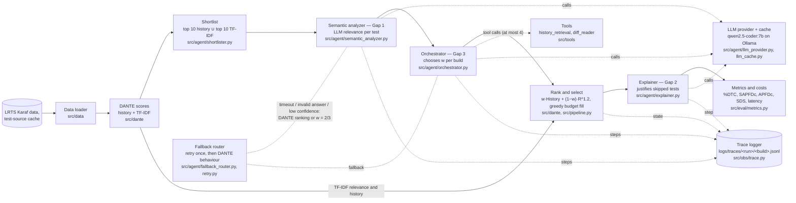

# Agentic Semantic Reasoning for Dynamic Test Selection in Long-Running CI Pipelines (AI4015, group G2-05)

## 1. Overview

Large projects re-run long test suites on every code change. When only part of the suite can run within a time budget (5%, 10% or 20% of the full suite's run time), test selection decides which test classes to run so that as many failing tests as possible are caught. The base paper, DANTE (ICST 2026), ranks tests by two signals: how often and how persistently a test failed before (history) and how similar its source is to the changed code (TF-IDF relevance), combined with one fixed rule. This project keeps DANTE as the baseline and adds an agentic layer on a local LLM (`qwen2.5-coder:7b` on Ollama) for three gaps. Gap 1: a semantic analyzer replaces TF-IDF word overlap with the LLM's judgement of whether a test is affected by the change. Gap 2: an explainer writes a short, evidence-based justification for important tests that were skipped. Gap 3: an orchestrator agent inspects each change, may call tools, and chooses the weight between history and relevance for that build. Every component can be switched off for ablation, every LLM answer is validated and falls back to DANTE's behaviour when it fails, and every agent step is logged. The system was evaluated on 44 test-split builds of Apache Karaf from the LRTS dataset; the results below report honestly where it helped and where it did not.

## 2. Architecture



Dotted lines are the side components: the fallback router (robustness) and the trace logger (agent trajectories). The same diagram, with the gap mapping, is in [`docs/architecture.md`](docs/architecture.md).

The switch is the method that runs the system without that component (method names as in `docs/PROJECT_CONTEXT.md` §5.2).

| Component | What it does | Turned off in |
|---|---|---|
| Data loader (`src/data`) | Reads one build in time order: test results, durations, diff, test sources (from the source cache or the git clone), and the 100 earlier builds as history. | — (always on) |
| DANTE scores (`src/dante`) | History score (failure rate + sticky failures) and TF-IDF relevance for every candidate. | — (always on) |
| Shortlist (`src/agent/shortlister.py`) | Keeps the top 10 tests by history and the top 10 by TF-IDF; only these are sent to the LLM, the rest get relevance 0. | `Full system (no shortlist)`: the LLM scores every candidate |
| Semantic analyzer, **Gap 1** (`src/agent/semantic_analyzer.py`) | One LLM call per shortlisted test returns a relevance 0–1, a reason and a confidence; the prompt is anonymised and truncated. | `Agent-weighted (TF-IDF)`: TF-IDF relevance instead of LLM relevance |
| Orchestrator, **Gap 3** (`src/agent/orchestrator.py`, `src/tools`) | Sees the build's features and the shortlist scores, may call `history_retrieval` or `diff_reader` (at most 4 tool calls), then answers `{w, confidence, reason}`. | `LLM-relevance` (fixed w = 2/3) and `Tuned-weight (LLM)` (fixed w tuned on dev) |
| Rank and select (`src/dante`, `src/pipeline.py`) | Orders tests by `value_w` and fills each budget (5%, 10%, 20%) greedily. | — (always on) |
| Explainer, **Gap 2** (`src/agent/explainer.py`) | For each budget, up to 5 important skipped tests get a short justification that cites the evidence it was given. It never changes the selection. | `Agent-weighted`: same selection, no explanations |
| Metrics and costs (`src/eval/metrics.py`) | %DTC, SAPFDc, APFDc, SDS against the real outcomes (used only here), plus latency, tokens, tool calls and time saved. | — (always on) |
| LLM provider and cache (`src/agent/llm_provider.py`, `llm_cache.py`) | Calls Ollama (or `MockProvider` in tests) with temperature 0 and a seed; every successful answer is cached on disk with its original latency and token counts. | `--provider mock` replaces the model |
| Fallback router (`src/agent/fallback_router.py`, `src/agent/retry.py`) | Retries a timed-out or invalid call once, then falls back: a failed relevance call gives the build the DANTE ranking, a failed orchestrator decision gives w = 2/3; each fallback is a `FallbackRecord`. | — (always on) |
| Trace logger (`src/obs/trace.py`) | Writes every step (state, LLM call, tool call, decision, fallback, explanation) of a build to a JSONL trace; `src/obs/export_sample.py` renders chosen traces into `logs_sample/`. | — (always on in `experiments.run_experiment`; code that passes no trace logger gets `NullTrace`, which records nothing) |

## 3. Installation

Requires Python 3.12 and Git (on Windows also run `git config core.longpaths true`).

```
gh repo clone bilalabbasi14/project-g2-agentic-ci
cd project-g2-agentic-ci
python -m venv .venv
.venv\Scripts\python -m pip install -r requirements.txt        # Windows
.venv/bin/python -m pip install -r requirements.txt            # Linux / macOS
python -m pytest                                               # needs no data and no model
```

`requirements.txt` pins numpy 1.26.4, pandas 2.3.2 and scikit-learn 1.7.2, the versions in DANTE's lock file: the order of tests with equal scores, and so the selected tests, depends on them (see the limitations below).

**Data** (never committed). The LRTS Karaf data, DANTE's stored results and the test-source cache are private Kaggle datasets shared with the group. Download and point the config at them as described in [`data/README.md`](data/README.md) ("Phase 2: getting the data" and "Phase 2: test-source cache"), then check them:

```
python -m src.data.check_data
```

**Optional: a local LLM.** Install Ollama (`winget install Ollama.Ollama` on Windows, https://ollama.com on Linux/macOS), then `ollama pull qwen2.5-coder:7b`, and check it with `python -m src.agent.llm_smoke`. Without a GPU a call takes tens of seconds; the real runs were made on Kaggle (section 6).

## 4. Configuration and environment variables

All settings are in [`config.yaml`](config.yaml); [`config_kaggle.yaml`](config_kaggle.yaml) has the same keys with Kaggle paths (a test checks that only the paths differ). Do not edit `config.yaml` for personal paths: copy it to `config_local.yaml` (git-ignored) and select it with `G2_CONFIG`.

| Section | What it sets |
|---|---|
| `project`, `paths` | project name (`karaf`); data folders (`lrts_root`, `dante_root`, `dante_solutions`, `repo_clone`) and repo-relative output folders |
| `budgets` | selection budgets as fractions of the suite time (0.05, 0.10, 0.20) |
| `history`, `dante` | DANTE's history window (100 builds), sticky windows, weights, relevance exponent 1.2, random seed 42 |
| `llm` | model, Ollama URL, timeout per call, temperature 0, JSON mode, diff and test-source truncation |
| `shortlist`, `fallback` | shortlist size k = 10 per signal; fallback scope (`build`) and minimum confidence |
| `eval` | evaluation set file (`data_eval/eval_builds_p2.csv`), seeds 1–3, seeds with the explainer on (1) |
| `llm_p2` | context window, one retry, LLM cache folder, relevance prompt version (`v1`, chosen on dev) |
| `orchestrator` | at most 4 tool calls, minimum confidence, fallback w = 2/3, prompt version (`o2`) |
| `explainer` | up to 5 skipped tests per build and budget, candidate pool, justification length, prompt version |
| `single_call` | the single-call baseline's limits, context window and its own timeout (480 s, set on dev) |
| `tuning` | the w grid and objective for the tuned-weight baselines (dev split only) |
| `ablation` | the no-shortlist ablation's builds (all 44 test builds) and seeds |
| `trace`, `paths_p2` | trace folder and text limit; the test-source cache folder |

Environment variables, listed in [`.env.example`](.env.example). The code reads them from the shell environment and does not load a `.env` file, so set them in the shell (PowerShell `$env:G2_CONFIG="config_local.yaml"`, bash `export G2_CONFIG=config_local.yaml`). A local `.env` copy is git-ignored.

| Variable | Meaning |
|---|---|
| `G2_CONFIG` | config file to use (default `config.yaml`; the Kaggle notebook sets `config_kaggle.yaml`) |
| `OLLAMA_HOST` | Ollama server used when no `--base-url` is given (before `llm.base_url` of the config) |
| `OLLAMA_HOST_2` | the second Ollama server on Kaggle (`http://localhost:11435`), for reference; the notebook passes both servers with `--base-url` |

A GitHub token is never stored in a file: on Kaggle it is a Kaggle Secret named `GITHUB_TOKEN`.

## 5. How to run

Both commands need the data (section 3). They run every method of experiment E3 (`DANTE-CCH`, `DANTE-CCH-shipped`, `LLM-relevance`, `Tuned-weight (LLM)`, `Agent-weighted`, `Full system`) on the first test-split build, at 5%, 10% and 20%.

**One build with the mock provider** (no model; fixed fake answers, a few seconds):

```
python -m experiments.run_experiment --exp E3 --split test --seed 1 --provider mock --build-limit 1 --run-id demo_mock
```

**One build with Ollama** (a running Ollama server with `qwen2.5-coder:7b`):

```
python -m experiments.run_experiment --exp E3 --split test --seed 1 --build-limit 1 --run-id demo_ollama --base-url http://localhost:11434
```

Each writes `results/<run-id>/` (`per_build.csv`, `llm_relevance.csv`, `orchestrator_decisions.csv`, `explanations.csv`, `run_meta.json`, and the full `runs/<build>.json`) and the agent trace `logs/traces/<run-id>/<build>.jsonl`. Render a trace as readable Markdown with `python -m src.obs.export_sample --run-id demo_mock --n 1 --out <folder>`. Delete the demo folders afterwards; they are not results.

The Phase 1 command still works and runs the Phase 1 methods on one build: `python run_end_to_end.py --build PR-1840_build4 --budget 10 [--provider mock]`.

## 6. How to reproduce each experiment

The real runs were made on Kaggle with [`experiments/kaggle_runner.ipynb`](experiments/kaggle_runner.ipynb) (GPU T4×2, Internet on; inputs `karaf-data`, `g2-source-cache` and optionally `g2-llm-cache`; a Kaggle Secret `GITHUB_TOKEN`). Set `REPO_REF`, `EXP`, `SPLIT` and `SEEDS` in its first cell and use *Save & Run All (Commit)*. For each seed it starts two Ollama servers, runs

```
python -m experiments.run_experiment --exp <EXP> --split <SPLIT> --seed <seed> --shard 0/2 --base-url http://127.0.0.1:11434 --skip-existing
python -m experiments.run_experiment --exp <EXP> --split <SPLIT> --seed <seed> --shard 1/2 --base-url http://127.0.0.1:11435 --skip-existing
python -m experiments.merge_shards --run-id <EXP>_<SPLIT>_seed<seed>
```

with `G2_CONFIG=config_kaggle.yaml`, and zips `results/`, the traces and the LLM cache. Only the CSVs, `.md` files and `run_meta.json` are committed. Without Kaggle, the same `run_experiment` command runs on one machine without `--shard`.

| Experiment | Notebook settings (`EXP`, `SPLIT`, `SEEDS`) | Results written to | Wall-clock time on Kaggle T4×2 |
|---|---|---|---|
| E1 Baselines (`Random`, `History-only`, `TF-IDF-only`, `Tuned-weight (TF-IDF)`, `Single-call LLM`) | `E1`, `test`, `[1, 2, 3]` | `results/E1_test_seed{1,2,3}/` | 3.78 h for the three seeds |
| E2 Base paper on the test split (`DANTE-CCH`, `DANTE-CCH-shipped`) | `E2`, `test`, `[1]` (no model; locally: `--provider mock`) | `results/E2_test_seed1/` | about a minute (`started`/`finished` in its `run_meta.json`) |
| E2 Our port vs DANTE's stored results (50 Phase 1 builds) | `E2_stored`, `phase1`, `[1]` (no model; locally: `--provider mock`) | `results/E2_stored_phase1_seed1/` | about a minute |
| E3 Full system, and E4 Gaps 1 and 3 (`DANTE-CCH`, `DANTE-CCH-shipped`, `LLM-relevance`, `Tuned-weight (LLM)`, `Agent-weighted`, `Full system`; explainer on seed 1) | `E3`, `test`, `[1, 2, 3]` | `results/E3_test_seed{1,2,3}/`, traces sample in `logs_sample/E3_test_seed1/` | 1.40 h for the three seeds |
| E5 Ablation without LLM relevance (`Agent-weighted (TF-IDF)`) | `E5`, `test`, `[1, 2, 3]` | `results/E5_test_seed{1,2,3}/` | 0.08 h for the three seeds |
| E5 Ablation without shortlist (`Full system (no shortlist)`) | `E5_noshortlist`, `test`, `[1, 2, 3]` | `results/E5_noshortlist_test_seed{1,2,3}/` | 5.77 h for the three seeds |
| E6 Efficiency and reliability | no run of its own: computed from the cost columns of E1, E3 and E5 | `results/tables/efficiency.md` | — |
| Dev-split tuning (prompt, orchestrator, single-call timeout) | `DEV`, `dev`, `[1]` with `METHODS` and `RUN_ID` set, e.g. `--relevance-prompt v2` in `EXTRA_ARGS` | `results/DEV_*` | 0.49 h for the five dev runs |

The times are from `results/tables/efficiency.md` (GPU-hours = wall-clock hours of the runs containing the method). Later runs reused cached LLM answers where model, prompt, options and seed were identical, so a run from an empty cache can take longer.

Analysis, from the committed files (no data or model needed unless stated):

| Step | Command | Writes |
|---|---|---|
| Tuned weights (dev split; needs the data) | `python -m src.dante.tune_weight --relevance tfidf` and `--relevance llm --llm-relevance results/DEV_prompt_v1/llm_relevance.csv` | `results/tuning/`, `experiments/tuned_weights.yaml` |
| Prompt and orchestrator iterations (dev) | `python -m src.agent.prompt_eval --runs results/DEV_prompt_v1 results/DEV_prompt_v2`; `python -m src.agent.orchestrator_eval --runs results/DEV_orch_o1 results/DEV_orch_o2` | `results/dev/` |
| Shortlist recall (needs the data) | `python -m src.eval.shortlist_recall --split test --k 5 10 15 20` | `results/analysis/shortlist_recall_test.*` |
| Statistics | `python -m src.eval.stats --runs "results/E*_test_seed*/per_build.csv" --out results/stats` | `results/stats/` |
| Explanation rating (Gap 2) | `python -m src.eval.rating sample --run-dir results/E3_test_seed1 --n 100 --seed 42`, then `agreement` and `final` | `results/gap2/` |
| Failure analysis (needs the run JSONs and traces of R1) | `python -m src.eval.failure_analysis --run-dir results/E3_test_seed1 --runs-json <folder> --traces <folder> --ratings results/gap2/ratings_final.csv` | `results/analysis/`, `docs/cases/` |
| Tables, figures and the gap-resolution table | `python -m src.eval.report` | `results/tables/`, `results/figures/` |
| Development log | `python -m experiments.build_devlog` | `docs/devlog.md` |

## 7. Results

Test split: 44 Karaf builds, budgets 5/10/20%, seeds 1–3. Both tables are copied unchanged from `results/tables/`; they are generated by `python -m src.eval.report`. Per-gap details are in `results/tables/gap1.md`, `gap2.md`, `gap3.md`, the ablation in `ablation.md`, costs in `efficiency.md`, the statistics in `results/stats/summary.md`, the failure analysis in `results/analysis/failure_summary.md` and `docs/cases/`, and the figures in `results/figures/`.

### Main results

Written by `python -m src.eval.report`. %DTC and SAPFDc: mean over builds of the per-build mean over seeds ± std over seeds (`results/stats/seed_variability.csv`; — = one seed). APFDc of the full ranking and SDS: median over builds. APFDc follows DANTE's formula, which adds 1/(2n); SAPFDc = %DTC × APFDc of the selection can therefore exceed 1 slightly on small selections (`src/eval/metrics.py`).

| Method | Budget | Seeds | Builds | %DTC | SAPFDc | APFDc (median) | SDS (median) |
|---|---|---|---|---|---|---|---|
| Random | 5% | 3 | 44 | 0.032 ± 0.000 | 0.022 ± 0.000 | 0.547 | 0.691 |
| Random | 10% | 3 | 44 | 0.107 ± 0.000 | 0.039 ± 0.000 | 0.547 | 0.655 |
| Random | 20% | 3 | 44 | 0.219 ± 0.000 | 0.094 ± 0.000 | 0.547 | 0.589 |
| History-only | 5% | 3 | 44 | 0.282 ± 0.000 | 0.163 ± 0.000 | 0.798 | 0.615 |
| History-only | 10% | 3 | 44 | 0.398 ± 0.000 | 0.231 ± 0.000 | 0.798 | 0.587 |
| History-only | 20% | 3 | 44 | 0.492 ± 0.000 | 0.317 ± 0.000 | 0.798 | 0.506 |
| TF-IDF-only | 5% | 3 | 44 | 0.115 ± 0.000 | 0.083 ± 0.000 | 0.597 | 0.594 |
| TF-IDF-only | 10% | 3 | 44 | 0.248 ± 0.000 | 0.152 ± 0.000 | 0.597 | 0.562 |
| TF-IDF-only | 20% | 3 | 44 | 0.330 ± 0.000 | 0.212 ± 0.000 | 0.597 | 0.523 |
| DANTE-CCH-shipped | 5% | 3 | 44 | 0.283 ± 0.000 | 0.207 ± 0.000 | 0.770 | 0.586 |
| DANTE-CCH-shipped | 10% | 3 | 44 | 0.378 ± 0.000 | 0.264 ± 0.000 | 0.770 | 0.538 |
| DANTE-CCH-shipped | 20% | 3 | 44 | 0.522 ± 0.000 | 0.365 ± 0.000 | 0.770 | 0.500 |
| DANTE-CCH | 5% | 3 | 44 | 0.283 ± 0.000 | 0.226 ± 0.000 | 0.796 | 0.556 |
| DANTE-CCH | 10% | 3 | 44 | 0.356 ± 0.000 | 0.274 ± 0.000 | 0.796 | 0.521 |
| DANTE-CCH | 20% | 3 | 44 | 0.545 ± 0.000 | 0.370 ± 0.000 | 0.796 | 0.479 |
| Tuned-weight (TF-IDF) | 5% | 3 | 44 | 0.283 ± 0.000 | 0.207 ± 0.000 | 0.770 | 0.586 |
| Tuned-weight (TF-IDF) | 10% | 3 | 44 | 0.378 ± 0.000 | 0.264 ± 0.000 | 0.770 | 0.538 |
| Tuned-weight (TF-IDF) | 20% | 3 | 44 | 0.522 ± 0.000 | 0.365 ± 0.000 | 0.770 | 0.500 |
| Single-call LLM | 5% | 3 | 44 | 0.329 ± 0.000 | 0.241 ± 0.000 | 0.826 | 0.590 |
| Single-call LLM | 10% | 3 | 44 | 0.424 ± 0.000 | 0.304 ± 0.000 | 0.826 | 0.536 |
| Single-call LLM | 20% | 3 | 44 | 0.568 ± 0.000 | 0.406 ± 0.000 | 0.826 | 0.494 |
| LLM-relevance | 5% | 3 | 44 | 0.329 ± 0.000 | 0.222 ± 0.000 | 0.824 | 0.608 |
| LLM-relevance | 10% | 3 | 44 | 0.447 ± 0.000 | 0.287 ± 0.000 | 0.824 | 0.562 |
| LLM-relevance | 20% | 3 | 44 | 0.515 ± 0.013 | 0.380 ± 0.007 | 0.824 | 0.517 |
| Tuned-weight (LLM) | 5% | 3 | 44 | 0.329 ± 0.000 | 0.222 ± 0.000 | 0.819 | 0.603 |
| Tuned-weight (LLM) | 10% | 3 | 44 | 0.447 ± 0.000 | 0.282 ± 0.000 | 0.819 | 0.562 |
| Tuned-weight (LLM) | 20% | 3 | 44 | 0.537 ± 0.013 | 0.378 ± 0.007 | 0.819 | 0.521 |
| Agent-weighted | 5% | 3 | 44 | 0.306 ± 0.000 | 0.219 ± 0.000 | 0.848 | 0.600 |
| Agent-weighted | 10% | 3 | 44 | 0.424 ± 0.000 | 0.274 ± 0.000 | 0.848 | 0.577 |
| Agent-weighted | 20% | 3 | 44 | 0.560 ± 0.013 | 0.392 ± 0.007 | 0.848 | 0.507 |
| Full system | 5% | 3 | 44 | 0.306 ± 0.000 | 0.219 ± 0.000 | 0.848 | 0.600 |
| Full system | 10% | 3 | 44 | 0.424 ± 0.000 | 0.274 ± 0.000 | 0.848 | 0.577 |
| Full system | 20% | 3 | 44 | 0.560 ± 0.013 | 0.392 ± 0.007 | 0.848 | 0.507 |
| Agent-weighted (TF-IDF) | 5% | 3 | 44 | 0.283 ± 0.000 | 0.227 ± 0.000 | 0.796 | 0.556 |
| Agent-weighted (TF-IDF) | 10% | 3 | 44 | 0.356 ± 0.000 | 0.275 ± 0.000 | 0.796 | 0.521 |
| Agent-weighted (TF-IDF) | 20% | 3 | 44 | 0.545 ± 0.000 | 0.373 ± 0.000 | 0.796 | 0.479 |
| Full system (no shortlist) | 5% | 3 | 44 | 0.338 ± 0.000 | 0.246 ± 0.000 | 0.823 | 0.528 |
| Full system (no shortlist) | 10% | 3 | 44 | 0.441 ± 0.000 | 0.281 ± 0.000 | 0.823 | 0.514 |
| Full system (no shortlist) | 20% | 3 | 44 | 0.538 ± 0.013 | 0.392 ± 0.006 | 0.823 | 0.468 |

### Gap-resolution table

Written by `python -m src.eval.report`. "Addressed?" is set only by `resolve_gap`, which applies the rule fixed in `docs/PROJECT_CONTEXT.md` §8 before the results were seen:

- Gaps 1 and 3: **Fully** = the gap method beats every comparison method in its RQ on both %DTC and SAPFDc at the 10% budget, with Holm-corrected p < 0.05. **Partially** = it beats them on at least one metric or budget, or the improvement is not significant. **Not** = no improvement anywhere.
- Gap 2: **Fully** = both RQ2 conditions hold. **Partially** = one holds. **Not** = neither holds.

How the rule is applied: "beats" = a positive mean difference (gap method − comparison method) over the shared builds; "no improvement anywhere" = no positive mean difference against any comparison method at any metric and budget. RQ2 condition (a) holds when, at every budget, the mean decision + explanation time per build is below the mean test time saved per build; the number of builds where it holds is shown for reference. Condition (b) holds when at least 80% of the sampled justifications are rated sound.

| Gap | Method/component | Metric | Base paper result (DANTE-CCH, reproduced by us, at 10%) | Our result (at 10%) | Addressed? |
|---|---|---|---|---|---|
| Gap 1 | LLM-relevance (semantic analyzer) | %DTC, mean over builds | 0.356 | 0.447 (vs DANTE-CCH +0.091, p_Holm 0.0910; vs DANTE-CCH-shipped +0.068, p_Holm 0.0910) | Partially |
| Gap 1 | LLM-relevance (semantic analyzer) | SAPFDc, mean over builds | 0.274 | 0.287 (vs DANTE-CCH +0.013, p_Holm 0.2275; vs DANTE-CCH-shipped +0.023, p_Holm 0.4939) | Partially |
| Gap 2 | Full system (explainer) | Decision + explanation time vs test time saved, mean s per build | n/a (DANTE gives no explanations) | 86.4 s vs 1513.3 s saved; below on 43 of 44 builds | Partially |
| Gap 2 | Full system (explainer) | Share of the 100 sampled justifications rated sound (all budgets; RQ2 needs 0.80) | n/a (DANTE gives no explanations) | 0.640 (Cohen's kappa 0.705) | Partially |
| Gap 3 | Agent-weighted (orchestrator) | %DTC, mean over builds | 0.356 | 0.424 (vs DANTE-CCH +0.068, p_Holm 0.1665; vs Tuned-weight (LLM) -0.023, p_Holm 0.3173) | Partially |
| Gap 3 | Agent-weighted (orchestrator) | SAPFDc, mean over builds | 0.274 | 0.274 (vs DANTE-CCH -0.000, p_Holm 0.6764; vs Tuned-weight (LLM) -0.008, p_Holm 0.6784) | Partially |

- Gap 1 evidence: `results/stats/pairwise.csv` (family RQ1), `results/tables/gap1.md`, `results/tables/main_results.csv`.
- Gap 2 evidence: `results/tables/gap2.md` (from `results/E3_test_seed1/per_build.csv`), `results/gap2/rating_summary.csv`, `results/gap2/agreement.md`.
- Gap 3 evidence: `results/stats/pairwise.csv` (family RQ3), `results/tables/gap3.md`, `results/tables/gap3_w.md` (from `orchestrator_decisions.csv` of the test-split runs).

## 8. Changes since Phase 1

| Change | Reason |
|---|---|
| **Inference moved from a laptop CPU to free Kaggle T4 GPUs** (two Ollama servers, two shards; `experiments/kaggle_runner.ipynb`). | On the CPU a relevance call took 39.1 s on average (`results/initial_results.csv`); on a T4 it took 3.19 s in the dev run of the chosen prompt (`results/dev/prompt_comparison.csv`). The Phase 2 runs would not have fitted in the time otherwise. |
| **Python 3.12 environment on Kaggle, created with `uv`.** | Kaggle ships Python 3.13, but the pinned `numpy==1.26.4` needs Python 3.12 or older. |
| **Evaluation set enlarged from the 13 code-changing Phase 1 builds to all 54 qualifying builds**, with a fixed chronological split: the earliest 10 are `dev`, the other 44 `test` (`data_eval/eval_builds_p2.csv`). | Phase 1 had too few builds for statistics. The planned 120 builds did not exist: only 54 Karaf builds have 100 earlier builds, a code change, a failing test and readable sources (`data_eval/eval_set_p2_report.md`; `docs/devlog/2026-11-06-ali-eval-set-size.md`). |
| **One project (Karaf)** instead of results per project. | The compute budget (free Kaggle GPUs) covers one project; Phase 1 promised "overall and per project". |
| **Relevance prompt v2 tested on the dev split; v1 kept.** | v2 fixed the clustering of scores near 0 (share ≤ 0.2: 0.976 → 0.112) but gave a lower SAPFDc at 10% on dev (0.6671 vs 0.6725), and the rule fixed before the runs chooses by SAPFDc (`results/dev/prompt_comparison.csv`; `docs/devlog/2026-11-06-ali-relevance-prompt-v2.md`). |
| **Orchestrator prompt o2 instead of o1.** | With o1 the model copied the example answer and gave w = 0.5 on every dev build; o2 has no copyable numbers and gave 5 distinct w on dev (`results/dev/orchestrator_prompt_iterations.csv`; `docs/devlog/2026-11-07-ali-orchestrator-prompt.md`). |
| **Temperature 0 with seeds 1–3** passed to Ollama for repeated runs; an on-disk LLM cache keyed by model, prompt, options and seed; one retry before a fallback. | Repeated runs as the course requires, reruns and ablations without paying for the same calls twice, and fewer fallbacks (`docs/devlog/2026-11-06-ali-llm-cache.md`). |
| **Explanations generated for seed 1 only**, at all three budgets, for at most 5 important skipped tests per build and budget. | The explainer never changes the selection, so other seeds would only repeat its cost; limiting it to important skipped tests bounds the number of calls (`docs/devlog/2026-11-06-bilal-explainer.md`). |
| **The "single non-agentic LLM call" baseline is defined as one call per build** that receives the diff and the names of all candidates and returns a relevance for each (`Single-call LLM`). | Phase 1 promised a non-agentic LLM baseline without defining it. |
| **The single-call baseline has its own timeout (480 s)**, set from the slowest dev call (`results/DEV_single_call_timing/`). | With the general 60 s timeout every single-call answer timed out in the first R2 attempt (`docs/devlog/2026-11-08-bilal-run-r2.md`). |
| **Two DANTE variants are reported** (`DANTE-CCH` and `DANTE-CCH-shipped`), and the gap comparisons use `DANTE-CCH`. | The shipped DANTE code reads relevance under the wrong key and ranks on history only (`docs/dante_notes.md`; `docs/devlog/2026-10-20-bilal-two-dante-variants.md`). Kept from Phase 1. |
| **Statistics:** per build, results are averaged over seeds; Friedman test, pairwise Wilcoxon tests with Holm correction and rank-biserial effect sizes (`src/eval/stats.py`). | Phase 1 had no statistical tests. |

## 9. Development workflow

One-time setup on each laptop:

```
gh auth login
gh repo clone bilalabbasi14/project-g2-agentic-ci
cd project-g2-agentic-ci
git config user.name  "<your real name>"
git config user.email "<the email of your GitHub account>"
git config core.hooksPath .githooks
git config core.longpaths true
```

All changes go through pull requests; see docs/PROJECT_CONTEXT.md §11.

Run the tests with `python -m pytest`.

## 10. Known limitations and threats to validity

- **One project.** All results are on Apache Karaf; they may not hold for other projects or build systems.
- **Small evaluation set.** Only 54 Karaf builds qualify, so the test split has 44 builds and the dev split, used for all tuning, 10 (`data_eval/eval_set_p2_report.md`).
- **LLM pre-training contamination.** `qwen2.5-coder:7b` may have seen Apache Karaf's code during pre-training. The failure analysis checked every relevance reason, orchestrator reason and justification for identifiers absent from its prompt and found none (category F7: 0 pairs, `results/analysis/failure_summary.md`), but a string check cannot detect knowledge the model uses without naming it.
- **No flaky-test labels.** LRTS gives outcomes 0 and 1 only (`data/README.md`), so %DTC_FLK is not reported.
- **Shortlist limit.** Tests outside the shortlist get LLM relevance 0. With k = 10, the share of test builds whose shortlist contains every failing test is 0.614, the share where it contains none is 0.250, and the mean recall is 0.676 (`results/analysis/shortlist_recall_test.md`).
- **A 7B local model.** Larger models might judge relevance and choose weights differently; the orchestrator never called a tool in the test runs (`results/tables/efficiency.md`, tool calls per build 0.00).
- **Explanations:** a share of 0.247 of the explainer's answers failed validation (`results/tables/efficiency.md`, "Explanations failed"), and a share of 0.640 of the 100 rated justifications was rated sound (`results/gap2/rating_summary.md`), rated by two group members.
- **Seeds.** At temperature 0 most methods gave identical results for the three seeds (`results/stats/seed_variability.csv`), so the standard deviations show reproducibility, not robustness.
- **Cache and timing.** Some LLM answers came from the cache; the stored latencies are the original ones, but wall-clock run times are shorter than for a run from an empty cache.
- **Platform.** The results were produced on Kaggle (Linux). On a Windows laptop with the same pinned library versions, the order of tests with equal DANTE scores differed, so the history- and TF-IDF-based methods selected different tests (`docs/devlog/2026-10-20-bilal-pin-library-versions.md`).
- **Energy was not measured**; costs are reported as latency, tokens and GPU-hours.

## 11. Repository layout

Owner = the member responsible for the file during Phase 2.

```
.github/workflows/tests.yml        CI: runs pytest on every PR                             Ali
.github/pull_request_template.md   PR checklist                                            Ali
.githooks/pre-push                 blocks direct pushes to main                            Ali
.env.example                       environment variables (no real values)                  Ali
CLAUDE.md                          review rules for Claude Code reviewers                  Ali
config.yaml, config_kaggle.yaml    all settings; Kaggle paths                              Ali
requirements.txt                   pinned dependencies                                     Ali
run_end_to_end.py                  Phase 1 command line, wrapper around src/pipeline.py    Ali
src/settings.py                    load_config(), repo_path()                              Ali
src/contracts/                     dataclasses and JSON Schemas                            Ali
src/pipeline.py                    runs any set of methods on one build                    Ali
src/agent/llm_provider.py          Ollama and mock providers, seeds, servers               Ali
src/agent/llm_cache.py, retry.py   on-disk LLM answer cache; one retry                     Ali
src/agent/semantic_analyzer.py     Gap 1: relevance prompts v1 and v2                      Ali
src/agent/shortlister.py           top-k history ∪ top-k TF-IDF                            Ali
src/agent/fallback_router.py       relevance fallbacks                                     Ali
src/agent/orchestrator.py          Gap 3: per-build weight with tools                      Ali
src/agent/prompt_eval.py           relevance prompt comparison on dev                      Ali
src/agent/orchestrator_eval.py     orchestrator prompt iterations on dev                   Ali
src/agent/explainer.py             Gap 2: justifications for skipped tests                 Taha
src/agent/single_call.py           single-call LLM baseline                                Taha
src/agent/llm_smoke.py             checks a local Ollama server                            Ali
src/tools/                         history_retrieval, diff_reader, budget_tracker, registry  Ali
src/obs/trace.py, export_sample.py trace logger; trace samples for logs_sample/            Ali
src/data/                          loader, splitter, sources, source cache, evaluation set, data check  Bilal, Ali
src/dante/                         DANTE port, stored comparison, tune_weight.py           Bilal
src/eval/metrics.py, stored.py, compare_baselines.py, summarize.py   metrics, Phase 1 comparisons  Taha
src/eval/stats.py                  Friedman, Wilcoxon, Holm, effect sizes                  Taha (run by Bilal)
src/eval/rating.py                 rating sheets, Cohen's kappa                            Taha
src/eval/shortlist_recall.py       shortlist recall                                        Bilal
src/eval/failure_analysis.py       failure categories and cases                            Bilal
src/eval/report.py                 tables, figures, gap-resolution table                   Bilal
experiments/                       methods.yaml, configs/ (E1-E6, DEV), run_experiment.py, merge_shards.py,
                                   kaggle_runner.ipynb, build_devlog.py, comparisons.yaml  Ali
experiments/tuned_weights.yaml     output of tuning                                        Bilal
data_eval/                         eval_builds.csv (Phase 1, 50 builds), eval_builds_p2.csv (Phase 2 set and split)  Bilal, Ali
results/<run_id>/                  per-run CSVs and run_meta.json (no runs/)               whoever ran it
results/dev/, results/tuning/      dev-split prompt, orchestrator and weight tuning        Ali, Bilal
results/stats/, results/tables/, results/figures/, results/analysis/   statistics, tables, figures, failure analysis  Bilal
results/gap2/                      rating sample, both sheets, agreement, final ratings    Ali, Bilal
logs_sample/                       representative traces (JSONL and Markdown)              whoever ran it
docs/PROJECT_CONTEXT.md            project description and rules                           Ali
docs/architecture.md               architecture diagram and components                     Ali
docs/devlog/, docs/devlog.md       one file per devlog entry; the generated log            everyone
docs/cases/                        two success and two failure cases                       Bilal
docs/contracts.md, dante_notes.md  data contracts; notes on the DANTE code                 Ali, Bilal
tests/                             tests; no data and no model needed                      everyone
```

Never committed: the data, the source cache, the LLM cache (`cache/`), full run JSONs (`results/**/runs/`), full logs (`logs/`), `.env`, tokens or keys.

## 12. Credits and licences

- DANTE: "DANTE: Data-Driven Test Case Selection and Prioritization for
  Long-Running Test Suites", ICST 2026, and its replication package (MIT licence).
  The baseline in `src/dante/` is a port of that code; module docstrings cite the
  original functions.
- LRTS (Long Running Test Suites) dataset, https://ieeexplore.ieee.org/document/10044820.
- Apache Karaf, https://github.com/apache/karaf.
- R. Cheng, S. Wang, R. Jabbarvand and D. Marinov, "Revisiting test-case prioritization on long-running test suites", ISSTA 2024; artifact: https://doi.org/10.5281/zenodo.12662090.
- `qwen2.5-coder:7b` (Qwen team, Alibaba Cloud), run locally with Ollama.
