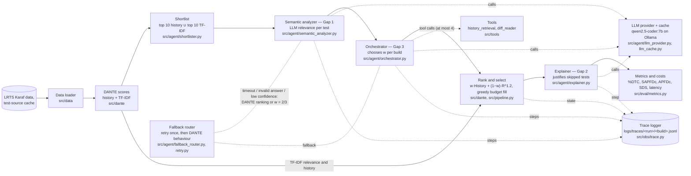

# Architecture (Phase 2)

The main path runs left to right for every build. Dotted lines are the side components: the fallback router (robustness) and the trace logger (agent trajectories). Every method in `experiments/methods.yaml` runs a subset of this path; `src/pipeline.py` runs any set of methods on one build and shares the LLM work between them.

## Components and the switch that turns each one off

The switch is the method that runs the system without that component (method names as in `docs/PROJECT_CONTEXT.md` §5.2).

| Component | What it does | Turned off in |
|---|---|---|
| Data loader (`src/data`) | Reads one build in time order: test results, durations, diff, test sources (from the source cache or the git clone), and the 100 earlier builds as history. | — (always on) |
| DANTE scores (`src/dante`) | History score (failure rate + sticky failures) and TF-IDF relevance for every candidate. | — (always on) |
| Shortlist (`src/agent/shortlister.py`) | Keeps the top 10 tests by history and the top 10 by TF-IDF; only these are sent to the LLM, the rest get relevance 0. | `Full system (no shortlist)`: the LLM scores every candidate |
| Semantic analyzer, **Gap 1** (`src/agent/semantic_analyzer.py`) | One LLM call per shortlisted test returns a relevance 0–1, a reason and a confidence; the prompt is anonymised and truncated. | `Agent-weighted (TF-IDF)`: TF-IDF relevance instead of LLM relevance |
| Orchestrator, **Gap 3** (`src/agent/orchestrator.py`, `src/tools`) | Sees the build's features and the shortlist scores, may call `history_retrieval` or `diff_reader` (at most 4 tool calls), then answers `{w, confidence, reason}`. | `LLM-relevance` (fixed w = 2/3) and `Tuned-weight (LLM)` (fixed w tuned on dev) |
| Rank and select (`src/dante`, `src/pipeline.py`) | Orders tests by `value_w` and fills each budget (5%, 10%, 20%) greedily. | — (always on) |
| Explainer, **Gap 2** (`src/agent/explainer.py`) | For each budget, up to 5 important skipped tests get a short justification that cites the evidence it was given. It never changes the selection. | `Agent-weighted`: same selection, no explanations |
| Metrics and costs (`src/eval/metrics.py`) | %DTC, SAPFDc, APFDc, SDS against the real outcomes (used only here), plus latency, tokens, tool calls and time saved. | — (always on) |
| LLM provider and cache (`src/agent/llm_provider.py`, `llm_cache.py`) | Calls Ollama (or `MockProvider` in tests) with temperature 0 and a seed; every successful answer is cached on disk with its original latency and token counts. | `--provider mock` replaces the model |
| Fallback router (`src/agent/fallback_router.py`, `src/agent/retry.py`) | Retries a timed-out or invalid call once, then falls back: a failed relevance call gives the build the DANTE ranking, a failed orchestrator decision gives w = 2/3; each fallback is a `FallbackRecord`. | — (always on) |
| Trace logger (`src/obs/trace.py`) | Writes every step (state, LLM call, tool call, decision, fallback, explanation) of a build to a JSONL trace; `src/obs/export_sample.py` renders chosen traces into `logs_sample/`. | — (always on in `experiments.run_experiment`; code that passes no trace logger gets `NullTrace`, which records nothing) |

## Where each research gap is addressed

| Gap | Component | Measured in |
|---|---|---|
| Gap 1: TF-IDF word overlap misses semantic links between a change and a test | Semantic analyzer | E4, RQ1: `LLM-relevance` vs `DANTE-CCH` and `DANTE-CCH-shipped` (`results/tables/gap1.md`) |
| Gap 2: skipped tests are not explained | Explainer | E4, RQ2: explanation cost vs time saved, and 100 rated justifications (`results/tables/gap2.md`) |
| Gap 3: one fixed history/relevance weight for every change | Orchestrator with tools | E4, RQ3: `Agent-weighted` vs `DANTE-CCH` and `Tuned-weight (LLM)` (`results/tables/gap3.md`) |

`docs/architecture.png` is the diagram of the Phase 1 proposal and is kept for reference.
